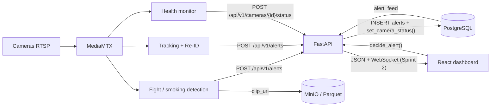
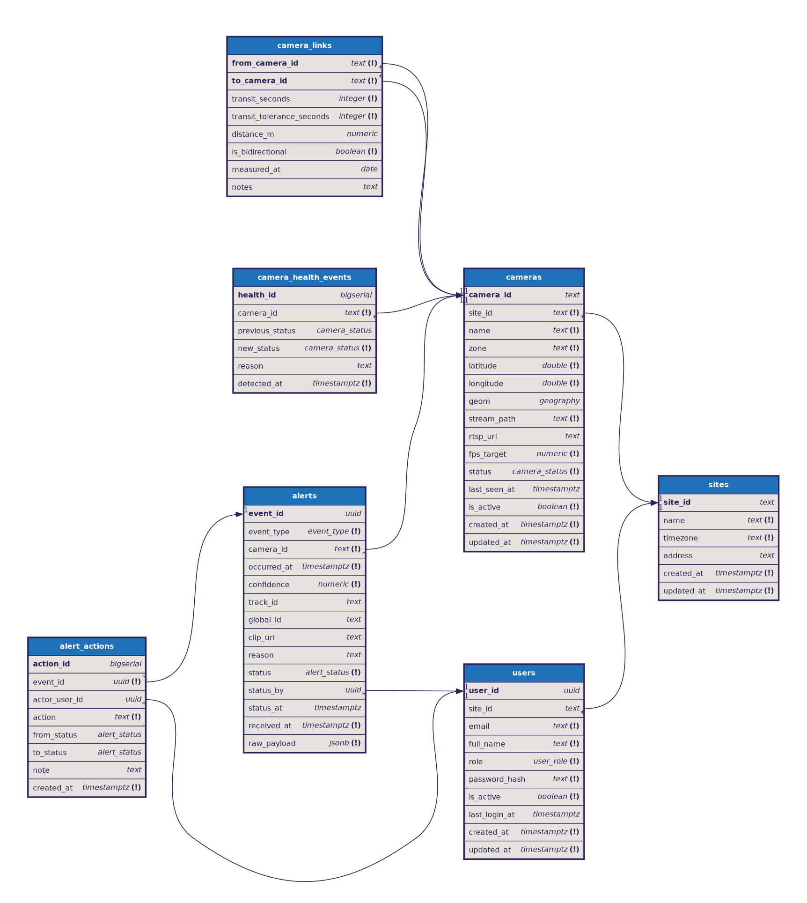
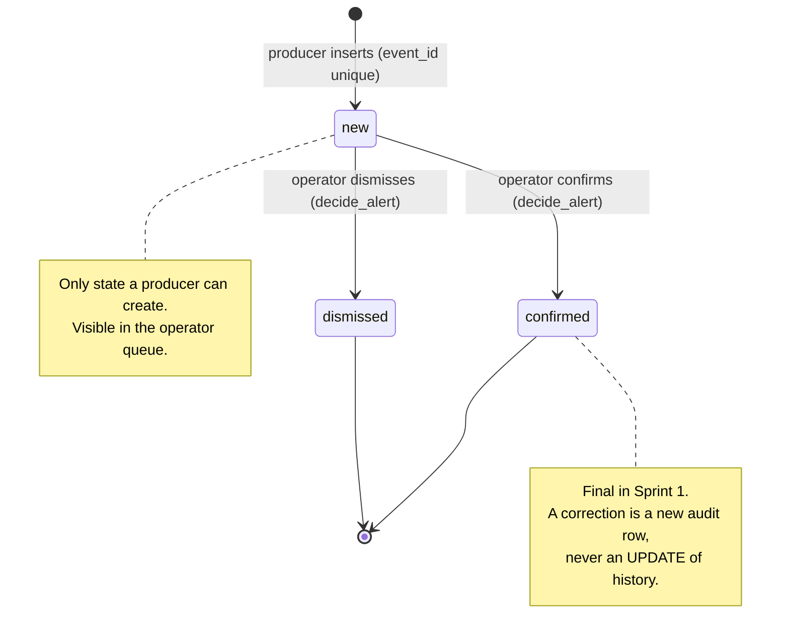

# Database design - cameras, alerts and decisions

**Project:** Cloud Surveillance and Smart Security Platform (College Scope)
**Sprint:** 1 - data design
**Author:** Mohamed Gehad Abdelmonem - Backend & Frontend
**Version:** draft 2.0 - 27 October 2026
**Status:** ready for team review

---

## 1. What this document is

The scope document asks for a platform where cameras stream, AI services raise
alerts, a human operator confirms or dismisses them, and the admin sees camera
health and incident history. Every one of those features reads or writes one of
seven core tables. This document fixes those tables **before** any feature code is
written, so the AI team, the dashboard and the API can work in parallel.

It covers:

* the conceptual model and the ER diagram;
* the physical schema (types, keys, constraints, indexes);
* the only two write paths that change state (health status, operator decision);
* privacy, retention and access control;
* what is deliberately left out of Sprint 1, and how it will be added.

**Artifacts**

| File | What it is |
| --- | --- |
| `db/schema.postgres.sql` | Executable DDL, 7 core tables, comments on every important column |
| `db/schema.phase2.postgres.sql` | Additive DDL for the next features (recordings, GIDs, retention, audit) |
| `db/seed.sql` | One site, four cameras, the camera graph, a demo actor, one alert |
| `db/schema.dbml` | Same model for dbdiagram.io / the rendered ER |
| `docs/diagrams/er-core.png` / `.svg` | The diagram included below |
| `scripts/validate_schema.py` | Executes the schema on a throwaway PostgreSQL and asserts 21 invariants |

**Validation status:** the core schema, the seed and the phase-2 schema were applied
to a real PostgreSQL 16 instance and passed 21 assertions (constraints, the two
functions, the views, the indexes). The embedded test server does not ship PostGIS,
so `cameras.geom` and its trigger are the only parts validated by syntax review
rather than execution; they are standard PostGIS and will be exercised on the
deployment database.

---

## 2. Requirements this schema must satisfy

Traced from the scope document, so nothing is invented:

| Scope requirement | Where it lives |
| --- | --- |
| 4-6 cameras, each with a location on a map | `cameras.latitude/longitude/geom`, `sites` |
| Camera registration with neighbours and measured transit times | `camera_links`, `camera_edges` view |
| Fight and smoking alerts with confidence and a clip | `alerts` (`event_type`, `confidence`, `clip_uri`) |
| Camera disconnected / frozen detection | `alerts` + `camera_health_events` |
| One event contract for every service | `alerts` columns = the agreed fields |
| Operator confirms or dismisses, with an audit trail | `alerts.status`, `alert_actions` |
| Global ID across cameras | `alerts.global_id` (phase 2: `tracked_persons`, `person_tracks`) |
| Login with roles | `users.role` (`user_role` enum) |
| Replay by camera and time | phase 2: `recording_segments` |
| Retention and privacy policy | phase 2: `site_settings` + MinIO lifecycle |
| "Design allows other sites later" | `sites`, `cameras.site_id`, `users.site_id` |
| Audit log | `alert_actions` (domain) + phase 2 `audit_log` (auth/admin) |

**Explicit non-goals for this draft:** face recognition (the scope forbids it),
billing, notifications delivery (derived from alerts), and video bytes inside
PostgreSQL (they live in MinIO).

---

## 3. Design principles

1. **The database is the contract.** A field that exists in the API but not in a
   column does not survive a restart. Every agreed event field has a column.
2. **One row per real occurrence.** Not per frame, not per model inference. The
   debounce lives in the AI service, so the operator queue stays usable.
3. **Immutable facts, mutable views.** An alert is inserted once and never
   rewritten, except its decision fields. History (decisions, health changes) is
   append-only.
4. **Natural keys for reference data, UUIDs for facts.** `CAM-001` and `BUC-MAIN`
   are readable in logs and alerts. `event_id` is a UUID because producers
   generate it offline.
5. **Constraints in the database, not only in the API.** A second decision, a
   confidence of 1.4 or a decided alert with no actor must be impossible even if
   someone connects with `psql`.
6. **Privacy by design.** Appearance only, no faces or names, retention limits,
   least privilege on the one sensitive column (`cameras.rtsp_url`).
7. **Do not pre-optimise.** Six cameras do not justify partitioning, sharding or
   a cache. Numbers are in section 12.

---

## 4. Conceptual model

Seven concepts, seven tables:

```
Site 1---* Camera
Camera 1---* Alert *---1 User (decision)
Camera 1---* CameraLink *---1 Camera
Camera 1---* CameraHealthEvent
Alert 1---* AlertAction *---1 User (actor)
```

* **Site** - a campus. One today, the model already allows more.
* **Camera** - a stream with a place on the map, a MediaMTX path and a health state.
* **CameraLink** - a directed edge of the camera graph with a measured walking
  time. This is what turns "a person disappeared" into "a person can reappear
  here, in this time window".
* **Alert** - a fact: something happened on a camera at a time, with a confidence
  and a status. The same table holds AI detections and camera-fault events,
  because the operator handles both in one queue.
* **AlertAction** - what a human (or the system) did about an alert. Append-only.
* **User** - operator, college admin or system admin.
* **CameraHealthEvent** - the status timeline behind `cameras.status`.

### 4.1 Where the database sits



Two rules keep the data trustworthy:

1. **Only the API touches PostgreSQL.** The AI services never open a database
   connection; they post JSON with a service credential, so one place validates
   the contract and one place enforces the rules.
2. **Only the functions change state.** `decide_alert()` and `set_camera_status()`
   are `SECURITY DEFINER`: the API role can execute them but has no `UPDATE`
   privilege on `alerts.status*` or `cameras.status`.

---

## 5. ER diagram



Vector version: [`diagrams/er-core.svg`](diagrams/er-core.svg).
Interactive version: paste `db/schema.dbml` into <https://dbdiagram.io>.
Regenerate the image with `python scripts/render_er.py`.

### Cardinalities

| Relationship | Cardinality | Delete rule | Why |
| --- | --- | --- | --- |
| `sites` -> `users` | 1 : N (nullable) | RESTRICT | a user may be scoped to one site |
| `sites` -> `cameras` | 1 : N | RESTRICT | a camera cannot exist outside a site |
| `cameras` -> `alerts` | 1 : N | RESTRICT | deleting a camera would orphan incident history |
| `users` -> `alerts` (decision) | 1 : N | RESTRICT | a decision must stay attributable |
| `cameras` -> `camera_links` (from/to) | 1 : N | CASCADE | a removed camera leaves no dangling edge |
| `alerts` -> `alert_actions` | 1 : N | CASCADE | deleting an alert (retention) deletes its history |
| `users` -> `alert_actions` (actor) | 1 : N | RESTRICT | audit actors are never deleted |
| `cameras` -> `camera_health_events` | 1 : N | CASCADE | timeline belongs to the camera |

`alerts.global_id` has **no foreign key** on purpose: the tracking pipeline may
publish the alert a few hundred milliseconds before the `tracked_persons` row is
committed. A foreign key here would drop valid alerts.

---

## 6. Enumerations

| Type | Values | Used by | Why an enum |
| --- | --- | --- | --- |
| `event_type` | `fight`, `smoking`, `camera_disconnected`, `camera_frozen`, `person_handoff` | `alerts.event_type` | fixed by the scope; the API and the dashboard switch on it |
| `alert_status` | `new`, `confirmed`, `dismissed` | `alerts.status`, `alert_actions.from_status/to_status` | a three-state machine, not free text |
| `camera_status` | `online`, `offline`, `frozen`, `unknown` | `cameras.status`, `camera_health_events` | health panel needs a closed set |
| `user_role` | `security_operator`, `college_admin`, `system_admin` | `users.role` | RBAC is defined on three roles |

Adding an event type is one `ALTER TYPE ... ADD VALUE` (safe and transactional in
PostgreSQL 12+). Removing or renaming a value is a migration - the list is part
of the API contract, so it changes only by team agreement.

---

## 7. Data dictionary (core)

Conventions: `timestamptz` everywhere (stored UTC, displayed in
`sites.timezone`), `text` instead of `varchar`, `numeric(4,3)` for confidence.

### 7.1 `sites`

| Column | Type | Null | Default | Rules |
| --- | --- | --- | --- | --- |
| `site_id` | text | PK | - | `^[A-Z0-9][A-Z0-9-]{1,31}$`, e.g. `BUC-MAIN` |
| `name` | text | no | - | 2-120 chars |
| `timezone` | text | no | `Africa/Cairo` | IANA name; drives "time of day" features |
| `address` | text | yes | - | - |
| `created_at` / `updated_at` | timestamptz | no | `now()` | `updated_at` maintained by trigger |

### 7.2 `users`

| Column | Type | Null | Default | Rules |
| --- | --- | --- | --- | --- |
| `user_id` | uuid | PK | `gen_random_uuid()` | never reused |
| `site_id` | text | yes | - | NULL = all sites; FK -> `sites` |
| `email` | text | no | - | unique on `lower(email)`, must contain `@` |
| `full_name` | text | no | - | 2-120 chars |
| `role` | `user_role` | no | `security_operator` | RBAC |
| `password_hash` | text | no | - | Argon2id/bcrypt; never returned by the API |
| `is_active` | boolean | no | `true` | deactivate instead of delete |
| `last_login_at` | timestamptz | yes | - | updated by the auth service |
| `created_at` / `updated_at` | timestamptz | no | `now()` | - |

### 7.3 `cameras`

| Column | Type | Null | Default | Rules |
| --- | --- | --- | --- | --- |
| `camera_id` | text | PK | - | `^[A-Z0-9][A-Z0-9_-]{2,63}$`, e.g. `CAM-001`; never reused |
| `site_id` | text | no | - | FK -> `sites` (RESTRICT) |
| `name` | text | no | - | 2-120 chars, shown on the map |
| `zone` | text | no | - | `Main Gate`, `Building A`, ... |
| `latitude` / `longitude` | double precision | no | - | validated range |
| `geom` | geography(Point,4326) | yes | derived | set by `cameras_set_geom` trigger |
| `stream_path` | text | no | - | unique, `^[a-z0-9][a-z0-9-]{1,63}$` (MediaMTX key) |
| `rtsp_url` | text | yes | - | `rtsp(s)://`; **sensitive**, internal only |
| `fps_target` | numeric(5,2) | no | 25 | 0 < fps <= 120 |
| `status` | `camera_status` | no | `unknown` | changed only via `set_camera_status()` |
| `last_seen_at` | timestamptz | yes | - | last frame or last heartbeat |
| `is_active` | boolean | no | `true` | soft delete |
| `created_at` / `updated_at` | timestamptz | no | `now()` | - |

### 7.4 `camera_links` (the camera graph)

| Column | Type | Null | Default | Rules |
| --- | --- | --- | --- | --- |
| `from_camera_id` | text | PK part | - | FK -> `cameras` (CASCADE) |
| `to_camera_id` | text | PK part | - | FK -> `cameras` (CASCADE), must differ from `from` |
| `transit_seconds` | integer | no | - | > 0, measured on site |
| `transit_tolerance_seconds` | integer | no | 5 | >= 0 and < `transit_seconds` |
| `distance_m` | numeric(8,2) | yes | - | >= 0 |
| `is_bidirectional` | boolean | no | `true` | reversed by the view when true |
| `measured_at` | date | yes | - | when the walk was timed |
| `notes` | text | yes | - | route description |

The tracker accepts a handoff only when
`abs(actual_transit - transit_seconds) <= transit_tolerance_seconds`, then compares
appearance embeddings. Example seed: gate -> corridor `10 s +/- 3 s`,
corridor -> labs `30 s +/- 8 s`.

### 7.5 `alerts` (the central fact table)

| Column | Type | Null | Default | Rules |
| --- | --- | --- | --- | --- |
| `event_id` | uuid | PK | - | producer-generated, idempotency key |
| `event_type` | `event_type` | no | - | 5 values |
| `camera_id` | text | no | - | FK -> `cameras` (RESTRICT) |
| `occurred_at` | timestamptz | no | - | API field `timestamp`; <= `received_at` + 10 min |
| `confidence` | numeric(4,3) | no | - | 0.000 - 1.000 |
| `track_id` | text | yes | - | 1-64 chars, ByteTrack, camera-local |
| `global_id` | text | yes | - | 1-64 chars, no FK (see 5) |
| `clip_uri` | text | yes | - | 1-1024 chars, optional this sprint |
| `reason` | text | yes | - | <= 500 chars, explainable alert text |
| `status` | `alert_status` | no | `new` | state machine |
| `status_by` | uuid | yes | - | FK -> `users`; required when decided |
| `status_at` | timestamptz | yes | - | required when decided |
| `received_at` | timestamptz | no | `now()` | server time, measures ingestion latency |
| `raw_payload` | jsonb | no | `'{}'` | original producer payload, never exposed |

Two table-level checks:

* `alerts_decision_complete` - a `new` alert has no actor/time; a decided alert
  has both. This makes half-finished decisions impossible.
* `alerts_occurred_not_after_receipt` - rejects a producer clock that is more
  than 10 minutes ahead of the server.

### 7.6 `alert_actions` (audit + training labels)

| Column | Type | Null | Default | Rules |
| --- | --- | --- | --- | --- |
| `action_id` | bigserial | PK | - | insertion order |
| `event_id` | uuid | no | - | FK -> `alerts` (CASCADE) |
| `actor_user_id` | uuid | yes | - | FK -> `users`; NULL only for `created` |
| `action` | text | no | - | `created`, `confirmed`, `dismissed`, `commented`, `reopened` |
| `from_status` | `alert_status` | yes | - | decision rows always start at `new` |
| `to_status` | `alert_status` | yes | - | decision rows land on `confirmed`/`dismissed` |
| `note` | text | yes | - | <= 1000 chars, operator comment |
| `created_at` | timestamptz | no | `now()` | - |

The table is append-only: there is no `UPDATE` path in the application, and the
decision function only inserts. This is what makes it usable as a label source
for human-in-the-loop retraining (innovation I-3).

### 7.7 `camera_health_events` (timeline)

| Column | Type | Null | Default | Rules |
| --- | --- | --- | --- | --- |
| `health_id` | bigserial | PK | - | - |
| `camera_id` | text | no | - | FK -> `cameras` (CASCADE) |
| `previous_status` | `camera_status` | yes | - | NULL for the first observation |
| `new_status` | `camera_status` | no | - | must differ from `previous_status` |
| `reason` | text | yes | - | e.g. `no frames for 12 s (timeout 10 s)` |
| `detected_at` | timestamptz | no | `now()` | - |

`cameras.status` is a denormalised cache of the last row here, for fast dashboard
reads. `set_camera_status()` writes both in one transaction, so they cannot drift.

---

## 8. Integrity rules (the short list)

| # | Rule | Enforced by |
| --- | --- | --- |
| 1 | An `event_id` is stored at most once | `alerts.event_id` PK |
| 2 | `confidence` is in [0,1] | `CHECK` + `numeric(4,3)` |
| 3 | A decided alert always has an actor and a time | `alerts_decision_complete` |
| 4 | Only `new` alerts can be decided | `decide_alert()` + row lock |
| 5 | Every decision is audited | `decide_alert()` inserts `alert_actions` |
| 6 | Unknown camera means no alert | FK + `ON DELETE RESTRICT` |
| 7 | Camera status changes always produce history | `set_camera_status()` |
| 8 | Repeated health states do not create noise | function no-op + `camera_health_status_changed` |
| 9 | `event_type` and `status` are closed sets | enums |
| 10 | A camera cannot link to itself | `camera_links_distinct` |
| 11 | A producer clock far in the future is rejected | `alerts_occurred_not_after_receipt` |
| 12 | A camera ID or site ID is well formed | `CHECK` regex |
| 13 | Users and cameras are never hard-deleted | `is_active` flags + `RESTRICT` FKs |
| 14 | Audit rows cannot be edited | no `UPDATE` grant on `alert_actions` |

---

## 9. Write paths

Only two operations change state in a way that must not be bypassed. Both are
database functions, so the rule survives a second client (a script, a notebook,
a future service).

### 9.1 `decide_alert(event_id, status, actor, note)`

```sql
SELECT decide_alert(
  '8f14e45f-ceea-4a67-9d2b-1b7c1e2f3a41',
  'confirmed',
  'b7c1f0a2-3d4e-4f56-8a90-1b2c3d4e5f60',
  'checked the clip'
);
```

1. rejects `new` as a decision and a missing actor;
2. `SELECT ... FOR UPDATE` the alert;
3. rejects an unknown alert and an already-decided one;
4. updates `status`, `status_by`, `status_at`;
5. inserts the `alert_actions` row;
6. returns the updated alert.

| SQLSTATE | Meaning | API mapping |
| --- | --- | --- |
| `P0002` | unknown alert | `404 alert_not_found` |
| `23514` | already decided / invalid target | `409 invalid_status_transition` |
| `23502` | missing actor | `401` (auth required) |

### 9.2 `set_camera_status(camera_id, status, reason, detected_at)`

Updates `cameras.status` (and `last_seen_at` when healthy) and inserts one
`camera_health_events` row **only when the state actually changed**. Calling it
with the same status is a no-op, so a flapping monitor cannot flood the timeline.

### 9.3 Ingestion path (plain insert)

`POST /api/v1/alerts` inserts one `alerts` row and one `alert_actions` row with
`action='created'` and `actor_user_id=NULL`. A duplicate `event_id` is a primary
key violation, which the API turns into `200 duplicate=true` (idempotent retry).

---

## 10. Alert lifecycle



`new` is the operator's working set (index `alerts_status_time_idx`). Resolved
alerts stay queryable for incident history and for the ML label export.

---

## 11. Access patterns and indexes

| # | Query | Shape | Index |
| --- | --- | --- | --- |
| Q1 | Operator queue | `status='new' ORDER BY occurred_at DESC` | `alerts_status_time_idx` |
| Q2 | Camera history / grid | `camera_id=? ORDER BY occurred_at DESC` | `alerts_camera_time_idx` |
| Q3 | Incident review | `occurred_at BETWEEN ? AND ?` + filters | Q1/Q2 depending on filter |
| Q4 | Person journey | `global_id=? ORDER BY occurred_at` | `alerts_global_time_idx` (partial) |
| Q5 | Alert detail | `event_id=?` | primary key |
| Q6 | Camera map / grid | full scan of 4-6 rows | none needed |
| Q7 | Graph neighbours | `camera_edges` | PK + `camera_links_reverse_idx` |
| Q8 | Health panel | `status <> 'online' AND is_active` | `cameras_attention_idx` (partial) |
| Q9 | Health timeline | `camera_id=? ORDER BY detected_at DESC` | `camera_health_camera_time_idx` |
| Q10 | Decision audit | `event_id=? ORDER BY created_at` | `alert_actions_event_idx` |
| Q11 | Login | `lower(email)=?` | `users_email_lower_key` |

There is deliberately **no index on `event_type`**: five values, low selectivity,
always combined with a time range or a camera. Add
`(event_type, occurred_at DESC)` only if a measured query needs it.
`alerts.raw_payload` is not indexed: it is for replay, not for search.

---

## 12. Capacity and growth

Assumptions (state them in the report, do not pretend they are measurements):

| Data | Assumption | Rows / year | Decision |
| --- | --- | --- | --- |
| `alerts` | 20 events per camera per day, 6 cameras | ~44k | single table, no partitioning |
| `alert_actions` | ~1.2 rows per alert | ~53k | single table |
| `camera_health_events` | state changes only | < 5k | single table |
| `cameras` / `camera_links` | 6 / 12 | negligible | - |
| `recording_segments` (phase 2) | 10-min segments, 6 cameras | ~315k | partition only above ~10M rows |
| `person_tracks` (phase 2) | ~500 tracks/day | ~180k | index by camera/time and GID |

PostgreSQL handles all of this on one small instance. Partitioning, read replicas
and a cache are **not** justified in Sprint 1; the thresholds are written down so
the decision is revisited with data, not by instinct.

---

## 13. Security, privacy and retention

### 13.1 Database roles (service level)

| Role | Rights | Used by |
| --- | --- | --- |
| `svc_api` | `SELECT`/`INSERT` on app tables; `EXECUTE` both functions; **no `UPDATE`** on `alerts.status*` or `cameras.status` | FastAPI |
| `svc_readonly` | `SELECT` on `alert_feed`, `alerts`, `alert_actions` | ML exports, external dashboards |

AI services do not connect to PostgreSQL at all: they call the API with a service
credential, so there is one validation point and one write path. Human users never
connect to PostgreSQL either; the API authenticates them and enforces the three
`user_role` permissions. `cameras.rtsp_url` is readable only by `svc_api` and is
never serialised to the browser.

These grants are a deployment step, not part of the DDL: role creation and
passwords are environment-specific, and a managed PostgreSQL may already provide
them. The DDL only requires that the migration role can create tables and
extensions.

### 13.2 Privacy by design (innovation I-4)

* No face recognition, no names, no biometric templates. Re-identification uses
  OSNet appearance embeddings only.
* `tracked_persons` stores an opaque `global_id`, first/last seen, no image.
* Embeddings live in MinIO/Parquet with a 30-day retention; the database stores
  only a URI.
* `alerts.reason` is behaviour text; producers must not put names or IDs of
  people in it.
* Staged recordings for evaluation need written consent (scope requirement).

### 13.3 Retention defaults

| Data | Default | Enforced by |
| --- | --- | --- |
| Alert clips | 30 days | MinIO lifecycle rule |
| Continuous recordings | 30 days | MinIO lifecycle rule |
| Appearance embeddings | 30 days | nightly job |
| `alerts` / `alert_actions` | 365 days | nightly job (after evaluation) |
| `camera_health_events` | 90 days | nightly job |
| `audit_log` | 730 days | nightly job |

The numbers are stored per site in `site_settings` (phase 2) and changeable by the
college administrator, not hard-coded in the application.

---

## 14. Phase 2 tables (designed, not built)

| Table | Why it is not in Sprint 1 | What it unlocks |
| --- | --- | --- |
| `recording_segments` | replay is not in the Sprint-1 endpoint | "play camera X between 14:00 and 14:15", clip materialisation |
| `tracked_persons` | depends on the re-ID pipeline | Global ID, person journey |
| `person_tracks` | depends on ByteTrack + OSNet | IDF1 / ID-switch evaluation (innovation I-1) |
| `site_settings` | admin UI does not exist yet | retention + face-blur policy per site |
| `audit_log` | auth does not exist yet | login/admin audit trail |

They reference the core tables with FKs and add nothing that forces a change to
the core DDL, which is the point: the design is additive.

---

## 15. Decisions and rejected alternatives

| # | Decision | Alternative rejected | Why |
| --- | --- | --- | --- |
| D1 | `event_id` UUID generated by the producer | sequence inside the API | retries and offline producers need a stable ID; UUID makes ingestion idempotent without a lock |
| D2 | One `alerts` table for all five event types | one table per type | one operator queue, one decision flow, one index; type is a column |
| D3 | Enums for fixed sets | lookup tables | values are part of the API contract; joins add nothing at this size |
| D4 | Readable keys for sites/cameras, UUIDs for alerts | UUID everywhere | `CAM-001` appears in every log line and event; UUIDs for facts avoid coordination |
| D5 | Denormalised `cameras.status` + history table | compute status from history | the dashboard reads the current state constantly; the function keeps them consistent |
| D6 | No FK on `alerts.global_id` | FK to `tracked_persons` | the alert may arrive before the GID is committed; a FK would drop valid alerts |
| D7 | Decisions via `decide_alert()` | `UPDATE` from the API | the state machine and the audit row cannot be bypassed |
| D8 | `clip_uri` nullable | require a clip | a MinIO failure must not lose an incident |
| D9 | No partitioning in Sprint 1 | monthly partitions now | ~44k alerts/year does not justify the operational cost; the threshold is documented |
| D10 | `sites` table now | add it later | the scope explicitly says other sites may be added; one FK today avoids a migration later |
| D11 | Tolerance stored with transit time | single average | a 30 s walk has a real window; the tracker needs `+/- tolerance` to reject impossible matches |
| D12 | No `notifications` table | per-user notification rows | the panel is a query over alerts + health events; a second copy would drift |
| D13 | Append-only `alert_actions` | mutable "last decision" columns | audit and ML labels need the full history, including corrections |

Other alternatives considered and rejected:

* **Event sourcing** (every change as an event): powerful, but too much for a
  one-semester MVP and the team would spend the sprint on infrastructure.
* **JSONB-only events** (`payload jsonb`): flexible, but no constraints, no
  indexes worth using, and the AI team could ship a typo silently.
* **Clips as `bytea` in PostgreSQL**: backs up the database with video, kills
  MinIO's purpose, and makes replay slow.
* **Soft delete on every table**: only cameras and users need it; alerts are
  immutable and retained by policy.
* **A `zones` table with polygons**: useful later for geofencing, but the current
  map only needs a label. Promote `cameras.zone` when polygons are required.

---

## 16. Impact on the Sprint-1 API

The alert contract does not change. Three small adjustments are needed when the
code is written against this schema:

1. `POST /api/v1/cameras` must set `site_id` (default `BUC-MAIN` from config until
   the multi-site UI exists).
2. Operator decisions need a real `users.user_id`; the temporary `X-User-Id`
   header becomes the JWT subject, and the seed provides a demo operator.
3. `GET` responses may include `site_id` later; until then the dashboard ignores it.
4. The health monitor needs an internal `POST /api/v1/cameras/{id}/status`
   endpoint that calls `set_camera_status()` (fault alerts alone cannot express
   "the camera is healthy again"). It is not exposed to the dashboard.

No endpoint needs a different event field, so the AI team can start emitting
alerts against the agreed contract immediately.

---

## 17. Open questions for the team

| # | Question | Owner | Default until answered |
| --- | --- | --- | --- |
| Q1 | Minimum confidence to store an alert (all vs >= 0.5)? | AI leads | store all, filter in the dashboard |
| Q2 | Debounce per event type | AI leads | smoking 3 frames, fight 1.5 s, health on change |
| Q3 | One materialised clip per alert, or a window into a recording? | AI + backend | clip URI when available, else recording window |
| Q4 | Should `person_handoff` appear in the operator queue? | Dashboard owner | map + history only |
| Q5 | Retention numbers approved by the college? | College admin | 30 / 365 days |
| Q6 | Global camera ID prefix for a second site | Backend | `<SITE>-CAM-001` |
| Q7 | Do operators need an "acknowledged" state before confirm? | Dashboard owner | no, keep three states |

---

## 18. Review checklist

Use this to review the schema in ten minutes:

- [ ] Every agreed event field has a column and a type.
- [ ] A duplicate `event_id` cannot create a second row.
- [ ] A decided alert always has an actor and a timestamp.
- [ ] A second decision is impossible, not just discouraged.
- [ ] Camera status and its history cannot drift.
- [ ] Stop a camera: do the alerts survive? (yes, `RESTRICT`)
- [ ] Can a person's journey be queried without scanning everything?
- [ ] Is any private data stored that the scope forbids?
- [ ] Is there a retention path for clips, embeddings and alerts?
- [ ] Does adding recordings/GIDs require changing a core table? (no)
- [ ] Does the schema run on a real PostgreSQL? (`python scripts/validate_schema.py`)

---

## 19. File map

```
db/
  schema.postgres.sql          core DDL (7 tables, functions, views, triggers)
  schema.phase2.postgres.sql   additive DDL (5 tables)
  seed.sql                     demo site, cameras, graph, actor, alert
  schema.dbml                  ER source for dbdiagram.io
docs/
  database-design.md           this document
  er-diagram.md                one-page visual reference
  diagrams/er-core.png|svg     rendered ER
scripts/
  validate_schema.py           21 assertions on a throwaway PostgreSQL
  render_er.py                 regenerates the diagram from the DBML
```
