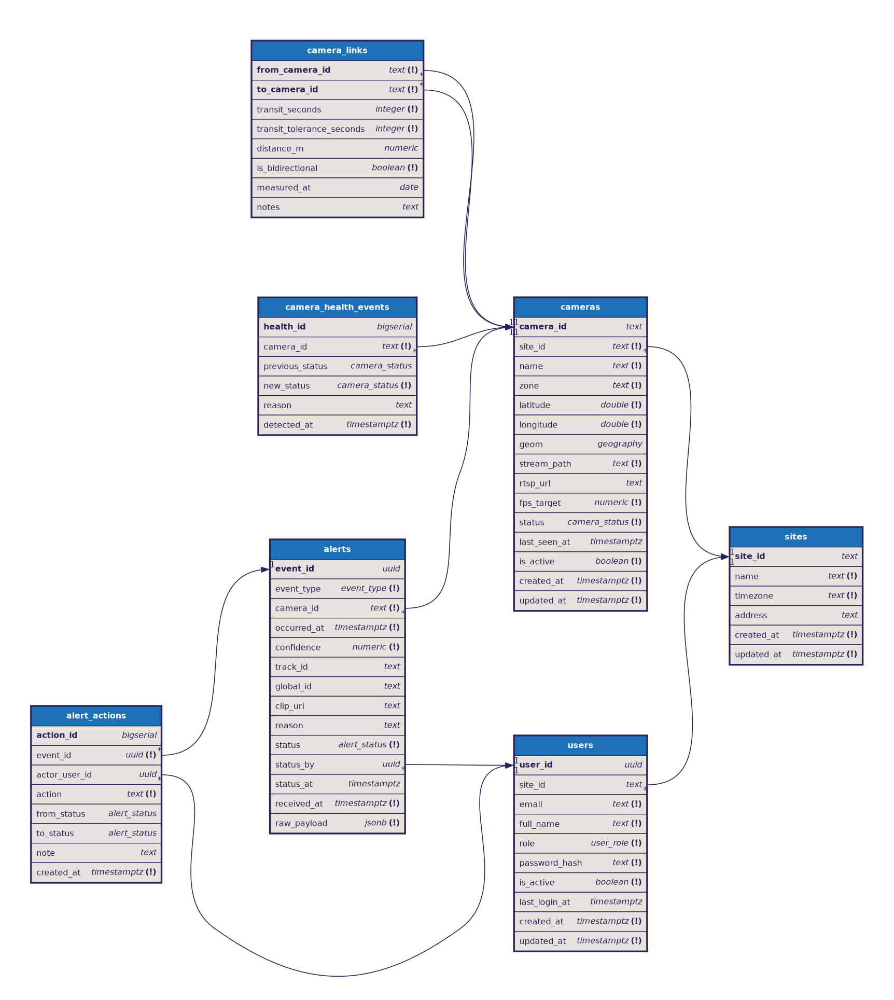

# ER diagram - Sprint 1 (one page)

Full rationale, data dictionary and decisions: [`database-design.md`](database-design.md).



Vector: [`diagrams/er-core.svg`](diagrams/er-core.svg) - use this one in Word/PowerPoint
(it stays sharp when scaled). Interactive: paste [`../db/schema.dbml`](../db/schema.dbml)
into <https://dbdiagram.io>.

**Legend:** bold column = primary key, `(!)` = NOT NULL, italic = column type,
the arrow points from the child (many) to the parent (one).

## The seven core tables

| Table | One row means | Key |
| --- | --- | --- |
| `sites` | a campus | `site_id` (`BUC-MAIN`) |
| `users` | a dashboard account | `user_id` (uuid) |
| `cameras` | a registered stream with a map position | `camera_id` (`CAM-001`) |
| `camera_links` | a measured walk between two cameras | (`from_camera_id`, `to_camera_id`) |
| `alerts` | one real event (fight, smoking, fault, handoff) | `event_id` (uuid, producer-generated) |
| `alert_actions` | one create/decision, append-only | `action_id` (bigserial) |
| `camera_health_events` | one health state change | `health_id` (bigserial) |

## Cardinalities

```
sites        1 ──< users            (a user may be scoped to one site)
sites        1 ──< cameras          (every camera belongs to a site)
cameras      1 ──< alerts           (RESTRICT: history survives camera removal)
users        1 ──< alerts           (the operator who decided)
cameras      1 ──< camera_links     (from and to; CASCADE)
alerts       1 ──< alert_actions    (CASCADE: history follows the alert)
users        1 ──< alert_actions    (the actor; RESTRICT)
cameras      1 ──< camera_health_events (CASCADE)
```

`alerts.global_id` is intentionally **not** a foreign key: an alert can arrive
before the tracking pipeline commits the `tracked_persons` row.

## Enumerations (not drawn, to keep the lines readable)

| Type | Values |
| --- | --- |
| `event_type` | `fight`, `smoking`, `camera_disconnected`, `camera_frozen`, `person_handoff` |
| `alert_status` | `new`, `confirmed`, `dismissed` |
| `camera_status` | `online`, `offline`, `frozen`, `unknown` |
| `user_role` | `security_operator`, `college_admin`, `system_admin` |

## Views

| View | Purpose |
| --- | --- |
| `camera_edges` | the camera graph in both directions, with transit time and tolerance |
| `alert_feed` | alerts joined with camera name/zone - what `GET /api/v1/alerts` returns |

## Phase 2 (designed, not in the picture)

`recording_segments`, `tracked_persons`, `person_tracks`, `site_settings`,
`audit_log` - see [`database-design.md`](database-design.md) section 14 and
[`../db/schema.phase2.postgres.sql`](../db/schema.phase2.postgres.sql).

## Regenerate the image

```powershell
python scripts/render_er.py
```

It reads `db/schema.dbml`, drops the enum boxes (listed above instead) and writes
`docs/diagrams/er-core.svg` + `.png` with consistent font metrics.
